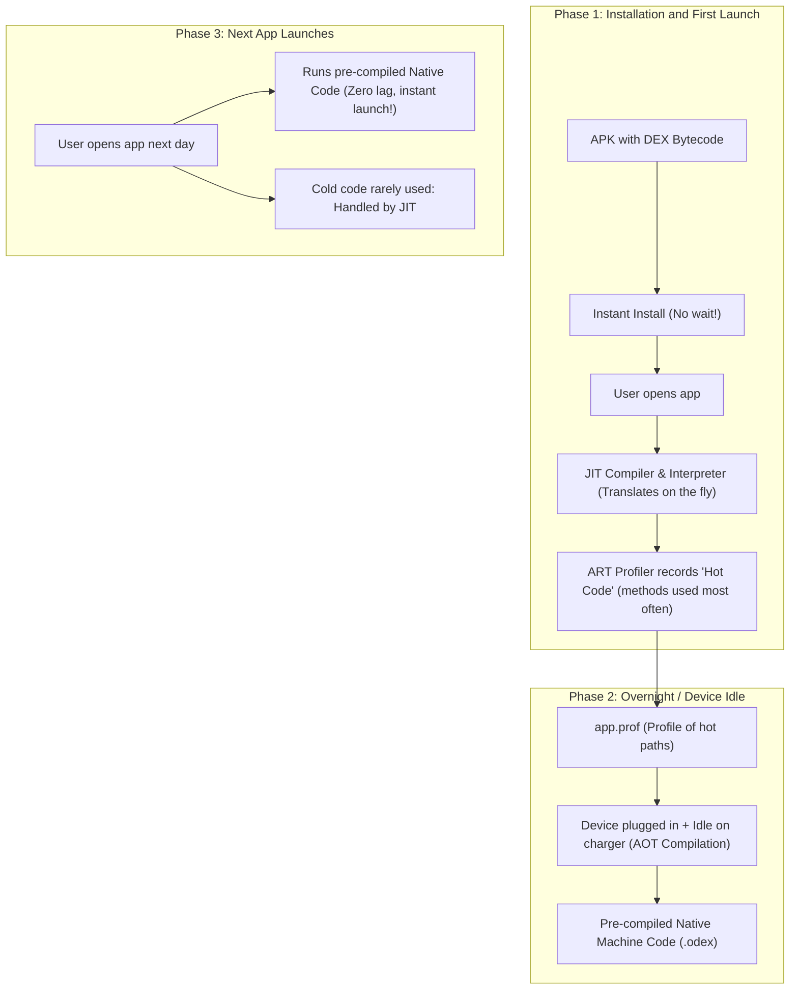

# 📱 Chapter 01: The Modern Android Landscape

Hey junior! Let’s start with the big picture before opening any heavy tools. 

You asked: **"Kotlin (I guess is the main thing right now?)"**  
Short answer: **100% yes.** Not only is it the main thing, it is the *only* thing you should be starting a new Android project with today.

Let's break down why Kotlin took over the world, how apps actually run on a device, and the tectonic shift that happened in Android UI.

---

## 1. Why Kotlin? What Happened to Java?

In 2008, Android started with Java. Java was fine, but over time, mobile developers ran into huge pain points:

1. **The Billion-Dollar Mistake (`NullPointerException`):**  
   In Java, any object reference can be `null`. If you call a method on a null reference, your app crashes immediately with `java.lang.NullPointerException`.
   - **Kotlin's Fix:** Nullability is built directly into the type system!
     ```kotlin
     var name: String = "Shaurya"
     // name = null  // ❌ Won't even compile!

     var nickname: String? = null // ✅ Explicitly nullable with '?'
     println(nickname?.length)     // Safe call: prints null, never crashes!
     ```

2. **Crushing Boilerplate:**  
   In Java, creating a simple model with 3 fields required 50 lines of getters, setters, `equals()`, `hashCode()`, and `toString()`.  
   - In Kotlin:
     ```kotlin
     data class User(val id: String, val name: String, val email: String)
     ```
     One line. Done.

3. **Google Made It Official ("Kotlin-First"):**  
   At Google I/O 2017, Google announced official support for Kotlin. In 2019, Google went further and declared Android development **Kotlin-First**. New Android APIs and Jetpack libraries are designed with Kotlin language features in mind.

4. **100% Java Interoperability:**  
   You can call Java code from Kotlin and Kotlin code from Java seamlessly. This allowed existing mega-apps (like Uber, Netflix, Spotify) to migrate to Kotlin incrementally without rewriting their entire codebases overnight.

---

## 2. The Big UI Shift: Jetpack Compose vs. Classic XML

For over a decade, Android UI was built using **XML layouts** and manipulated imperatively in Java/Kotlin:

```
[res/layout/activity_main.xml]  <-- Define widgets in XML
             ⬇
[MainActivity.kt]               <-- Find widget: findViewById<TextView>(R.id.title)
             ⬇
                                <-- Mutate widget: title.text = "Hello!"
```

### The Problem with the Classic Way:
- **Imperative UI:** You had to manually keep the UI in sync with your data. If your data changed, you had to remember to call `textView.text = ...`, `button.isEnabled = ...`, and `progressBar.visibility = GONE`.
- If you forgot one line, your UI got into an inconsistent state (e.g., loading spinner spinning forever even after data arrived).

### The Modern Way: Jetpack Compose (Declarative UI)
Similar to React, Flutter, or SwiftUI:
- **You don't mutate UI elements.** 
- Instead, **the UI is a function of state**: `UI = f(State)`.
- You write Kotlin code to describe what the UI should look like for a given state. When the state changes, Compose automatically re-renders ("recomposes") only the parts that changed.

```kotlin
@Composable
fun Greeting(name: String) {
    Text(text = "Hello, $name!")
}
```

> 🎯 **Senior Tip:** In this guide and all new Android projects today, we build exclusively with **Jetpack Compose**. Classic XML is now considered legacy maintenance.

---

## 3. How Does an Android Device Actually Run Your App?

When you click "Run" in Android Studio, what magic happens under the hood?

```
[Kotlin Source Code (.kt)]
           ⬇ (kotlinc compiler)
[Java Bytecode (.class)]
           ⬇ (D8 / R8 compiler)
[Dalvik Executable (.dex)]
           ⬇ (Packaged with resources, assets, and AndroidManifest.xml)
[APK or AAB bundle]
           ⬇ (Installed on Android Phone)
[Android Runtime (ART)] -> Executes machine code (AOT/JIT)
```

1. **Compilation:** Your Kotlin code is compiled down to Dalvik Executable (`.dex`) files. These are optimized bytecodes specifically designed for resource-constrained mobile devices.
2. **Packaging:** The `.dex` files, images, string resources, and the `AndroidManifest.xml` get zipped into an **APK** (Android Package) or **AAB** (Android App Bundle).
3. **ART (Android Runtime):** The engine on the phone that actually takes that `.dex` bytecode and translates it into raw CPU machine code (ARM / x86) so the processor can execute it.

---

## 4. Deep Dive: How Do JIT and AOT Work in Simple Terms?

Great question, junior! You hit on one of the coolest parts of the Android operating system. 

Phones have a dilemma:
- **CPUs don't understand `.dex` bytecode.** CPUs only understand machine instructions (binary 0s and 1s for ARM/Snapdragon/Tensor chips).
- Converting bytecode to machine instructions takes battery and CPU work.

To solve this, Android uses two strategies: **JIT** and **AOT**.

### The Real-World Analogy: Translating a Foreign Book 📖

Imagine you have a book written in Japanese (`.dex` bytecode), and your phone's CPU only speaks English (machine code).

| Strategy | Analogy | Pros | Cons |
| :--- | :--- | :--- | :--- |
| **JIT (Just-In-Time)** | **Live Interpreter sitting next to you.** As you read line 1, they whisper the English translation into your ear. | • Fast to start reading immediately (no waiting).<br>• Uses very little disk space. | • Slower while running.<br>• If you re-read the same sentence 100 times, the translator has to keep translating it over and over (wasting CPU & battery). |
| **AOT (Ahead-Of-Time)** | **Pre-translating the entire book before you ever read it.** A professional translator translates all 500 pages into English before you open the cover. | • Blazing fast once you start reading.<br>• Saves battery while reading. | • Takes a long time before you can start (slow app installation).<br>• Takes up a lot of extra storage space on your device. |

---

### The Evolution: Why Modern Android Uses Both (Hybrid JIT + AOT)

Android didn't always have the perfect balance:
1. **Old Android (Dalvik, Android 2.x - 4.4):** Pure **JIT**. Apps installed quickly, but lagged frequently while running.
2. **Android 5.0 (Early ART):** Pure **AOT**. Apps were 100% compiled during installation. The catch? Installing an app or updating your phone took 20+ minutes while the screen said *"Android is upgrading... optimizing app 42 of 120"*.
3. **Modern Android (Android 7.0+ to Present): Profile-Guided Hybrid Compilation!**

Modern ART combines the best of both worlds. Here is how it works:



### Breaking Down the Flow:
1. **Day 1 (Instant Install & JIT):**
   - You download the app. Install finishes in 2 seconds because no heavy AOT compilation happens.
   - When you open the app, **JIT** translates code as you tap around.
   - At the same time, a background **profiler** watches which screens and methods you actually use (your "hot code").
2. **At Night (AOT compilation while charging):**
   - When you plug your phone in to charge at night and the screen turns off, Android wakes up a background daemon.
   - It takes the profile of your "hot code" and runs **AOT compilation** on just those parts!
3. **Day 2 and Beyond (Blazing Speed):**
   - The next time you open the app, your most critical code (startup, feed scrolling, tapping buttons) is already 100% native machine code. It launches instantly and uses minimal battery.
   - Code you rarely touch (like the "Terms and Conditions" screen) stays uncompiled bytecode until you need it, saving device storage!

---

### Bonus Pro-Tip: "Baseline Profiles" (Google Play Cloud AOT)

You might ask: *"Can we get the AOT speed on Day 1 without waiting for the phone to charge overnight?"*

**Yes!** Google Play does this automatically today with **Baseline Profiles**:

Google Play ships the pre-compiled profile alongside the APK, giving users AOT startup speeds right on their very first launch.

---

## 5. Key Takeaways from Chapter 01

1. **Kotlin** is the standard language for Android: safe, expressive, modern.
2. **Jetpack Compose** is the standard toolkit for building Android UI today.
3. Every Android app boils down to compiled **DEX bytecode** packaged with **resources** running on **ART**.
4. **JIT translates on the fly** for quick startup, while **AOT compiles hot code ahead of time** (overnight or via Baseline Profiles) for butter-smooth execution and battery efficiency.

Now that we know what we're building with, let's explore **how to start a project from scratch**!

👉 Head over to [Chapter 02: Initializing a Project](file:///home/shaurya/Desktop/learning/android/docs/02_initializing_a_project.md).
