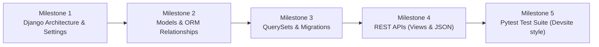

Got it! From here on, **you are in the driver's seat**. I will guide you, explain the "why" behind every concept, show you how it directly applies to `devsite` ([ESP-Website](https://github.com/learning-unlimited/ESP-Website)), and give you specific challenges to write and test yourself.

---

### 1. Behind the Scenes: What is `devsite`?

I inspected `/home/shaurya/Desktop/open-source/devsite`. Here is the core DNA of that project:

| Component | Devsite (ESP-Website) | Our TodoList Practice Project |
| :--- | :--- | :--- |
| **Framework** | **Django 5.2.x** | **Django 5.2.x** |
| **Language** | **Python 3.12+** | **Python 3.14** |
| **Test Runner** | `pytest` + `pytest-django` | `pytest` + `pytest-django` |
| **Linter / Style** | `flake8` (PEP 8) | `flake8` |
| **Architecture** | Multi-app modular Django (`esp/users`, `esp/program`, `esp/resources`) | Multi-app modular Django (`todos`, `accounts`) |
| **Settings** | Base settings + `local_settings.py` overrides | `settings.py` + optional `local_settings.py` |

---

### 2. Our Master Learning Roadmap

We will progress through 5 key milestones:



---

### Milestone 1: Django Architecture & Anatomy of a Project

Let’s understand how a Django project is organized and what each file does.

In your current workspace (`/home/shaurya/Desktop/learning/todoList`), we have:
1. [manage.py](file:///home/shaurya/Desktop/learning/todoList/manage.py): The entry point CLI command runner. You run commands through this (e.g. `python manage.py runserver`, `python manage.py makemigrations`).
2. [config/](file:///home/shaurya/Desktop/learning/todoList/config): The project configuration package:
   - `settings.py`: The single source of truth for configuration (database, installed apps, middleware).
   - `urls.py`: The "router" or table of contents for all URLs in your app.
   - `wsgi.py` / `asgi.py`: Web server gateways used for production deployment.
3. [todos/](file:///home/shaurya/Desktop/learning/todoList/todos): An isolated "Django App".
   - In Django, a **Project** contains one or more **Apps**.
   - In `devsite`, `esp` is the project, while `users`, `program`, and `resources` are individual apps.

---

### Your First Task: Register the `todos` App

When you create an app in Django (via `python manage.py startapp todos`), Django doesn't know it exists until you explicitly register it in [config/settings.py](file:///home/shaurya/Desktop/learning/todoList/config/settings.py).

#### How Django finds apps:
Open [config/settings.py](file:///home/shaurya/Desktop/learning/todoList/config/settings.py). Look for the `INSTALLED_APPS` list:

```python
INSTALLED_APPS = [
    'django.contrib.admin',
    'django.contrib.auth',
    'django.contrib.contenttypes',
    'django.contrib.sessions',
    'django.contrib.messages',
    'django.contrib.staticfiles',
    # your apps go here
]
```

#### Task for you:
1. Open [config/settings.py](file:///home/shaurya/Desktop/learning/todoList/config/settings.py).
2. Add `'todos',` to the `INSTALLED_APPS` list.
3. Open your terminal in `/home/shaurya/Desktop/learning/todoList`. Make sure your virtualenv is active:
   ```bash
   source .venv/bin/activate
   ```
4. Verify Django recognizes the app and checks for configuration errors by running:
   ```bash
   python manage.py check
   ```

Tell me what output you get when you run `python manage.py check`!