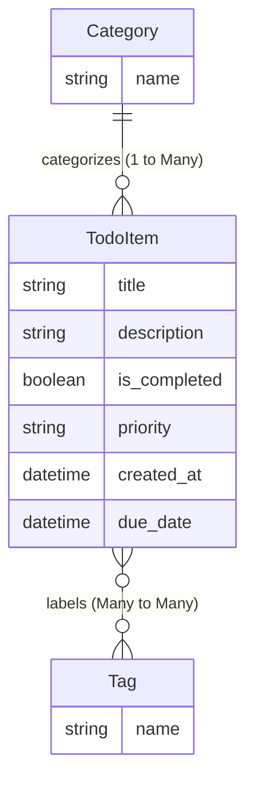

Ran command: `ls -la`
Ran command: `.venv/bin/pip list`

Good!

---

### Step-by-Step Initialization Commands

Open your terminal in `/home/shaurya/Desktop/learning/todoList` and run these commands in order:

#### 1. Activate the Virtual Environment
```bash
source .venv/bin/activate
```
*(Your prompt will show `(.venv)` when active.)*

#### 2. Initialize the Project Structure
```bash
django-admin startproject config .
```
> **Pro-Tip (Devsite style):** Notice the trailing space and dot (`.`)!  
> Without `.`, Django creates a nested folder `config/config/`. With `.`, it places `manage.py` right in your current directory and the project settings in `./config/`.

#### 3. Create the `todos` App
```bash
python manage.py startapp todos
```
This generates the `todos/` app directory containing `models.py`, `views.py`, `admin.py`, etc.

#### 4. Register the App in Settings
Open `config/settings.py`, find `INSTALLED_APPS`, and add `'todos',` to the list:
```python
INSTALLED_APPS = [
    'django.contrib.admin',
    'django.contrib.auth',
    'django.contrib.contenttypes',
    'django.contrib.sessions',
    'django.contrib.messages',
    'django.contrib.staticfiles',
    'todos',  # <-- Add your app here
]
```

#### 5. Apply Initial System Migrations
```bash
python manage.py migrate
```
*What this does:* Django sets up its built-in tables (users, permissions, sessions, admin logs) in `db.sqlite3`.

#### 6. Start the Development Server
```bash
python manage.py runserver
```
Visit `http://127.0.0.1:8000/` in your browser. You should see the classic Django rocket screen: **"The install worked successfully! Congratulations!"**

*(Press `Ctrl + C` in the terminal whenever you want to stop the server).*

---

# Milestone 2: The Django ORM & Database Modeling (Devsite Style)

Once your server works, let's understand how Django interacts with databases.

### 1. What is the ORM?
In traditional backend development, you write raw SQL:
```sql
CREATE TABLE todo (id INTEGER PRIMARY KEY, title VARCHAR(200), is_done BOOLEAN);
SELECT * FROM todo WHERE is_done = FALSE;
```
With **Django's ORM (Object-Relational Mapping)**, you write pure Python classes. Django converts your Python code into SQL queries automatically:
```python
# In Python
todos = TodoItem.objects.filter(is_done=False)
```

In `devsite`, you will almost **never** see raw SQL. Everything—from students registering for classes to classroom scheduling—is done through the ORM.

---

### 2. Anatomy of a Model in Django

Every database table is represented as a Python class inheriting from `models.Model`.

```python
from django.db import models

class Category(models.Model):
    name = models.CharField(max_length=100)
    created_at = models.DateTimeField(auto_now_add=True)

    def __str__(self):
        return self.name
```

#### Key Concepts to Understand:
1. **Fields define database columns:**
   - `models.CharField(max_length=...)`: Short text (translates to `VARCHAR`).
   - `models.TextField()`: Long unstructured text (translates to `TEXT`).
   - `models.BooleanField(default=False)`: True/False flag.
   - `models.DateTimeField(auto_now_add=True)`: Automatically sets the timestamp when created.
2. **The `__str__` method (Crucial Best Practice):**
   - Django uses this method whenever it displays the object in the Django Admin, the shell, or logs.
   - Without `__str__`, Django displays: `<Category: Category object (1)>`.
   - With `__str__`, it displays: `<Category: Work>`.

---

### 3. Relationships (Just like `devsite`)

In `devsite`, real-world entities are connected:
- A `ClassSection` belongs to a `ClassSubject` (One-to-Many).
- A `Program` has many `Resources` (One-to-Many or Many-to-Many).

In our `todoList` API, we will design 3 interconnected models:



1. **`ForeignKey` (One-to-Many):**
   - One `Category` can have many `TodoItem`s.
   - Each `TodoItem` belongs to one `Category`.
   - Syntax:
     ```python
     category = models.ForeignKey(Category, on_delete=models.CASCADE, related_name='todos')
     ```
   - **What is `on_delete=models.CASCADE`?**  
     If a `Category` is deleted, all todos inside it are automatically deleted.
   - **What is `related_name='todos'`?**  
     It allows reverse querying! From a category object, you can access all its todos: `work_category.todos.all()`.

2. **`ManyToManyField` (Many-to-Many):**
   - A `TodoItem` can have multiple `Tag`s (e.g. `#urgent`, `#home`).
   - A `Tag` can be applied to multiple `TodoItem`s.
   - Syntax:
     ```python
     tags = models.ManyToManyField(Tag, blank=True, related_name='todos')
     ```

---

### 4. The 2-Step Migration Dance

Whenever you create or change models in `models.py`, the database doesn't know about it yet. You must perform two steps:

```
[Edit models.py] 
       │
       ▼  (Step 1: python manage.py makemigrations)
[Blueprint file created in todos/migrations/0001_initial.py]
       │
       ▼  (Step 2: python manage.py migrate)
[SQL executed -> Tables created in db.sqlite3]
```

- **`makemigrations`**: Reads your `models.py` and creates a versioned blueprint file.
- **`migrate`**: Actually runs the SQL on your database to apply the blueprint.

---

### Your Next Hands-On Mission:

1. Follow the initialization steps (1 to 6) above if you haven't already and confirm your server runs.
2. Open `todos/models.py`.
3. Try drafting the models:
   - A `Category` model (`name`).
   - A `Tag` model (`name`).
   - A `TodoItem` model with:
     - `title` (`CharField`)
     - `description` (`TextField`, optional/blank)
     - `is_completed` (`BooleanField`, defaults to `False`)
     - `priority` (`CharField` with choices: `'LOW'`, `'MEDIUM'`, `'HIGH'`)
     - `category` (`ForeignKey` to `Category`, nullable if optional)
     - `tags` (`ManyToManyField` to `Tag`, blank=True)
     - `created_at` (`DateTimeField`, `auto_now_add=True`)

Give writing `todos/models.py` a try, or let me know if you want me to explain choices or fields in more detail first!