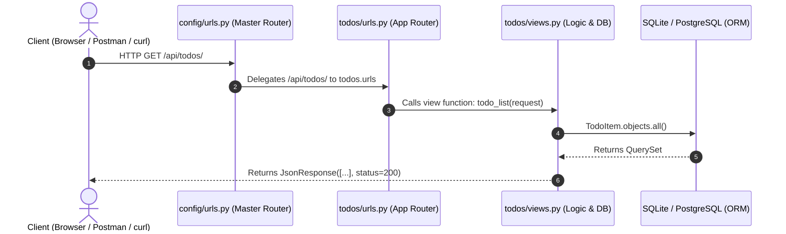

Awesome work! You now understand how models turn into SQL tables and how to query them using Django's ORM.

---

# Milestone 4: Building the REST API (Views, JSON & Routing)

Now let's build the API layer so external clients (like a frontend, a mobile app, or `curl`) can interact with our database over HTTP.

---

### 1. The Request-Response Lifecycle in Django

Whenever someone makes an HTTP request to your Django server, this exact pipeline runs:



---

### 2. REST API Design for our Todo App

We are going to build standard **RESTful endpoints**:

| Method | Endpoint | Description | HTTP Status |
| :--- | :--- | :--- | :--- |
| `GET` | `/api/todos/` | List all todos (with optional filters) | `200 OK` |
| `POST` | `/api/todos/` | Create a new todo | `201 Created` |
| `GET` | `/api/todos/<id>/` | Get details of a single todo | `200 OK` / `404 Not Found` |
| `PATCH` | `/api/todos/<id>/` | Update a todo (e.g., mark as completed) | `200 OK` / `400 Bad Request` |
| `DELETE`| `/api/todos/<id>/` | Delete a todo | `204 No Content` |

---

### 3. Core Django Concepts You Need to Know

#### A. `HttpRequest` and `JsonResponse`
In `todos/views.py`:
- `request.method`: Tells you if it's `'GET'`, `'POST'`, `'PATCH'`, `'DELETE'`, etc.
- `request.body`: Contains the raw JSON payload sent in `POST` or `PATCH` requests (you parse it with `json.loads(request.body)`).
- `request.GET`: Contains URL query parameters (like `?priority=HIGH`).
- `JsonResponse(data, status=...)`: Takes a Python `dict` or `list` and serializes it to JSON with the proper `Content-Type: application/json` header.

#### B. Serialization: Model to Dictionary
Databases return Python model instances (`TodoItem` objects), but `JsonResponse` cannot serialize a Django model directly. You must convert it into a dictionary:

```python
def serialize_todo(todo):
    """Helper function to convert a TodoItem model into a Python dictionary."""
    return {
        'id': todo.id,
        'title': todo.title,
        'description': todo.description,
        'is_completed': todo.is_completed,
        'priority': todo.priority,
        'category': todo.category.name if todo.category else None,
        'tags': [tag.name for tag in todo.tags.all()],
        'created_at': todo.created_at.isoformat(),
    }
```

#### C. Handling CSRF for APIs
Django has built-in **CSRF (Cross-Site Request Forgery)** protection for all `POST`, `PUT`, `DELETE` requests submitted via browser forms.
For raw REST APIs without session cookies, we use the `@csrf_exempt` decorator on API views:
```python
from django.views.decorators.csrf import csrf_exempt

@csrf_exempt
def todo_list_create(request):
    ...
```

#### D. Safe Object Fetching (`get_object_or_404`)
When looking up an item by ID:
```python
from django.shortcuts import get_object_or_404

# If id doesn't exist, Django automatically returns a 404 response!
todo = get_object_or_404(TodoItem, id=todo_id)
```

---

### 4. Step-by-Step Implementation Guide

#### Step 1: Wire up the Master URLs
Open [config/urls.py](file:///home/shaurya/Desktop/learning/todoList/config/urls.py). Include your app's URLs:

```python
from django.contrib import admin
from django.urls import path, include

urlpatterns = [
    path('admin/', admin.site.urls),
    path('api/todos/', include('todos.urls')),  # <-- Delegates /api/todos/ to todos/urls.py
]
```

#### Step 2: Create `todos/urls.py`
Create a new file `todos/urls.py` to route endpoints to their view functions:

```python
from django.urls import path
from . import views

urlpatterns = [
    path('', views.todo_list_create, name='todo-list-create'),
    path('<int:todo_id>/', views.todo_detail, name='todo-detail'),
]
```

#### Step 3: Write the Views in `todos/views.py`
Open `todos/views.py`. Implement two views:

1. **`todo_list_create(request)`**:
   - If `request.method == 'GET'`:
     - Query all todos using `TodoItem.objects.all()`.
     - *Bonus (Devsite style)*: Check `request.GET.get('is_completed')` to optionally filter by completed status!
     - Return `JsonResponse([serialize_todo(t) for t in todos], safe=False, status=200)`.
   - If `request.method == 'POST'`:
     - Parse JSON: `data = json.loads(request.body)`.
     - Create the todo: `todo = TodoItem.objects.create(title=data['title'], ...)`
     - Return `JsonResponse(serialize_todo(todo), status=201)`.

2. **`todo_detail(request, todo_id)`**:
   - Fetch the object: `todo = get_object_or_404(TodoItem, id=todo_id)`.
   - If `request.method == 'GET'`: return `JsonResponse(serialize_todo(todo))`.
   - If `request.method == 'PATCH'`:
     - Parse data and update fields (e.g. `todo.is_completed = data.get('is_completed', todo.is_completed)`).
     - Save it: `todo.save()`.
     - Return `JsonResponse(serialize_todo(todo))`.
   - If `request.method == 'DELETE'`:
     - `todo.delete()`.
     - Return `HttpResponse(status=204)` (or `JsonResponse({'message': 'Deleted'}, status=204)`).

---

### Your Next Hands-On Mission:

1. Wire up `config/urls.py` and create `todos/urls.py`.
2. Write the serialization helper and views in `todos/views.py`.
3. Test your new API using `curl` in a new terminal tab (or your browser for GET):
   ```bash
   # 1. Fetch all todos:
   curl http://127.0.0.1:8000/api/todos/

   # 2. Create a new todo via POST:
   curl -X POST http://127.0.0.1:8000/api/todos/ \
     -H "Content-Type: application/json" \
     -d '{"title": "Test from curl", "priority": "HIGH"}'

   # 3. Mark it completed via PATCH (replace 1 with your ID):
   curl -X PATCH http://127.0.0.1:8000/api/todos/1/ \
     -H "Content-Type: application/json" \
     -d '{"is_completed": true}'
   ```

Write the views and routes, test them out, and let me know how it goes!