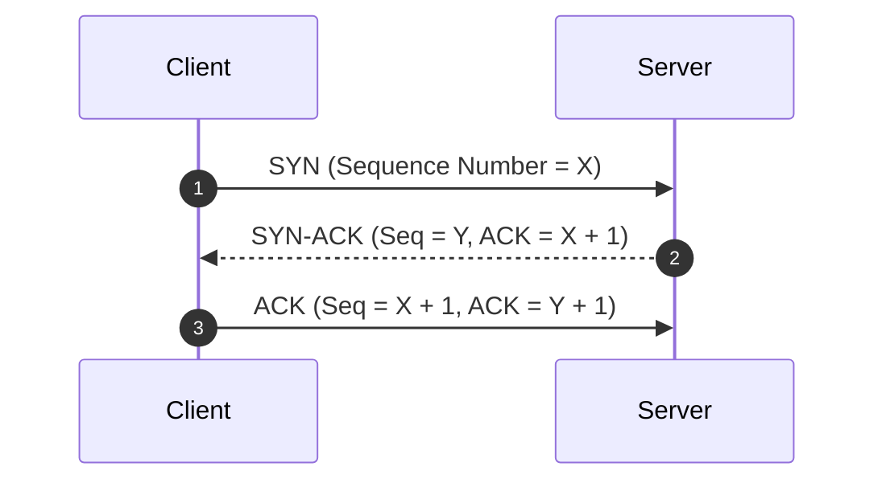

# Chapter 01: How the Web Works (The Under-The-Hood Journey)

> **Mentor Note:** "Junior, if an interviewer asks: *'What happens when you type a URL into a browser and press Enter?'* and you just say *'The browser sends a GET request and gets HTML'*, I will personally confiscate your mechanical keyboard. Let's see what *actually* happens across the wire."

---

## 🧭 The High-Level Map: From Keystroke to Pixels

When you type `https://api.shaurya.dev/v1/feed` and hit Enter, an epic relay race begins:

```
[Keystroke: URL entered]
         │
         ▼
 1. DNS Resolution ──────────► (Who is "api.shaurya.dev"? -> 104.21.55.2)
         │
         ▼
 2. TCP Handshake ───────────► (Establishing reliable transmission: SYN, SYN-ACK, ACK)
         │
         ▼
 3. TLS / SSL Handshake ─────► (Securing the pipe: Key Exchange & Certificates)
         │
         ▼
 4. HTTP Request Sent ───────► (Binary or plain-text bytes transmitted over socket)
         │
         ▼
 5. Server Processing & TTFB ─► (Load balancer -> Reverse proxy -> App server -> DB)
         │
         ▼
 6. HTTP Response Stream ────► (Packets arrive, TCP ACKs, OS Socket buffer drain)
         │
         ▼
 7. Browser Engine Magic ────► (DOM parsing, CSSOM, Render Tree, Paint, Compositing)
```

Let’s tear down each step like a senior engineer debugging a network trace.

---

## 🔍 Step 1: DNS Resolution (Finding the IP)

Computers don't route traffic via domain names like `google.com`; they route via IP addresses (`142.250.190.46` or IPv6 `2607:f8b0:4005:808::200e`). DNS is the phonebook of the internet.

### The Lookup Hierarchy (Look Local First!)
Before any packet leaves your computer, your system checks cache:

1. **Browser DNS Cache:** Chrome/Firefox keep an in-memory DNS cache (e.g., in Chrome: `chrome://net-internals/#dns`).
2. **OS Cache / Hosts file:** The operating system checks its DNS resolver cache (or `/etc/hosts` in Linux/Mac).
3. **Router Cache:** Your home Wi-Fi router often caches recent lookups.
4. **Recursive DNS Resolver (ISP or Public):** e.g., Cloudflare (`1.1.1.1`) or Google (`8.8.8.8`).

If the Recursive Resolver doesn't have it cached, it walks the global DNS tree:

```
[Recursive Resolver]
       │
       ├─► 1. Root Name Server (.)  ───► "I don't know, ask the .dev TLD server!"
       │
       ├─► 2. TLD Name Server (.dev) ──► "Ask Cloudflare's Authoritative Server for shaurya.dev!"
       │
       └─► 3. Authoritative Server ────► "Here is the exact A record: 104.21.55.2 (TTL: 300s)"
```

### 🧠 Senior Knowledge Drop: TTL & DNS Pre-fetching
- **TTL (Time to Live):** The number of seconds a DNS record can be cached. Low TTL = fast propagation of server changes, but higher DNS lookup traffic. High TTL = faster client response, but harder to switch servers in an incident.
- **DNS Prefetching in Web:**
  In HTML, you can tell the browser to resolve domains before the user clicks:
  ```html
  <link rel="dns-prefetch" href="https://api.shaurya.dev">
  <link rel="preconnect" href="https://api.shaurya.dev" crossorigin>
  ```
  *(Android comparison: In Android with OkHttp, connection pooling maintains open connections; in web, `preconnect` warms up the DNS, TCP, and TLS socket in advance!)*

---

## 🤝 Step 2: TCP 3-Way Handshake (Building the Reliable Pipe)

HTTP/1.1 and HTTP/2 rely on **TCP (Transmission Control Protocol)** at Layer 4 (Transport Layer).
TCP guarantees that:
1. Every packet arrives.
2. Packets arrive in order.
3. Corrupted packets get re-transmitted.

To create this connection, the client and server perform the **3-Way Handshake**:



### ⏱️ The Cost: 1 Round Trip Time (1 RTT)
If your user is in Mumbai and your server is in Virginia (USA), a single RTT might take ~180ms due to the speed of light in fiber optics. That's 180ms burned *just to say hello* before any data can be transferred!

---

## 🔒 Step 3: TLS / SSL Handshake (Locking the Door)

Nobody sends raw HTTP anymore; everything is HTTPS (HTTP over TLS). 
Once the TCP socket is open, the TLS handshake begins:

### TLS 1.2 (The Old Way - 2 RTTs):
1. **ClientHello:** "I support TLS 1.2, here are my cipher suites."
2. **ServerHello + Certificate:** "Let's use AES-GCM; here is my SSL certificate."
3. **Client Key Exchange:** Client verifies certificate with Root CAs, generates shared secret, encrypts it with server's public key.
4. **Finished:** Both sides derive symmetric session keys.

### TLS 1.3 (Modern Standard - 1 RTT or 0 RTT!):
In TLS 1.3, the client guesses the cipher algorithm and sends its key share **immediately** in the first `ClientHello` packet!
- Total cost: **1 RTT** to negotiate encryption.
- **0-RTT Session Resumption:** If the client has connected to this server before, it can send encrypted HTTP data on the very first packet!

```
[Total Handshake Cost Comparison]
TCP (1 RTT) + TLS 1.2 (2 RTT) = 3 RTTs before 1st byte of data!
TCP (1 RTT) + TLS 1.3 (1 RTT) = 2 RTTs!
HTTP/3 QUIC (0-1 RTT)         = 1 RTT (TCP + TLS combined over UDP)!
```

---

## 📦 Step 4: The Packet Lifecycle & TCP Slow Start

Now we can finally send our HTTP GET request! But how does the operating system send the data?

### 1. MTU & MSS (Packet Sizing)
- **MTU (Maximum Transmission Unit):** Usually **1500 bytes** for standard Ethernet.
- Minus 20 bytes (IP header) and 20 bytes (TCP header), leaving **MSS (Maximum Segment Size) = 1460 bytes**.
- Your data travels sliced into ~1.4 KB chunks.

### 2. The Golden Rule of Web Performance: The 14 KB Window (`initcwnd`)
When a TCP connection starts, it has no idea how fast or congested the network is. If it immediately blasts 10 megabytes of data, it will choke the router and drop packets.
So TCP uses **TCP Slow Start**:
- The server starts with a small **Congestion Window (`initcwnd`)**, typically **10 TCP segments** (~14.6 KB).
- It sends 14.6 KB. It waits for the client to send an ACK.
- Once ACKed, it doubles the window (20 segments -> 40 segments -> 80 segments).

> 🔥 **Senior Architect Takeaway:** 
> Your initial HTML document or critical JSON payload should ideally be **under 14 KB (gzipped)**!
> If your payload fits in the first 14 KB, it gets delivered in **1 single network round trip** without waiting for the slow-start ACK cycle!

---

## 📱 Android to Web Parallel: Where Does This Live?

| Concept | In Android (OkHttp / Retrofit) | In Web Browsers (Chrome / WebKit) |
| :--- | :--- | :--- |
| **DNS** | `okhttp3.Dns` interface (defaults to `InetAddress.getAllByName`) | Browser Network Process (Chromium Network Service) |
| **Connection Pool** | `ConnectionPool(maxIdleConnections, keepAliveDuration)` | Browser internal socket pool (Max 6 TCP connections per domain in HTTP/1.1) |
| **TLS Setup** | `CertificatePinner`, `SSLSocketFactory` | OS Certificate Store / NSS / BoringSSL |
| **Inspection Tool** | Android Profiler / Charles Proxy / Chucker | Chrome DevTools -> **Network Tab** (Timing Waterfall) |

---

## 🛠️ Inspecting it Yourself (Chrome DevTools Waterfall)

Open DevTools -> Network -> Click any request -> **Timing Tab**:
- **Queueing / Stalled:** Browser waiting for available socket connection.
- **DNS Lookup:** Time spent resolving domain to IP.
- **Initial Connection:** Time taken for the TCP 3-way handshake.
- **SSL:** Time taken for TLS handshake.
- **Request Sent:** Time taken to write bytes to the socket.
- **Waiting for server response (TTFB - Time To First Byte):** Server latency (database query, processing).
- **Content Download:** Time taken to stream the response packets across the wire.

---

### 🎯 Quiz Yourself Before Moving Forward:
1. Why does moving your server closer to users via a CDN (Edge locations) drastically improve handshake times?
2. Why is TLS 1.3 significantly faster than TLS 1.2 on mobile networks with high packet latency?
3. What is `TTFB`, and if TTFB is 800ms, is it typically a network pipe issue or a server/database issue?

Ready for the next level? Head over to **[Chapter 02: Communication Protocols](file:///home/shaurya/Desktop/learning/web/docs/02_communication_protocols.md)**!
