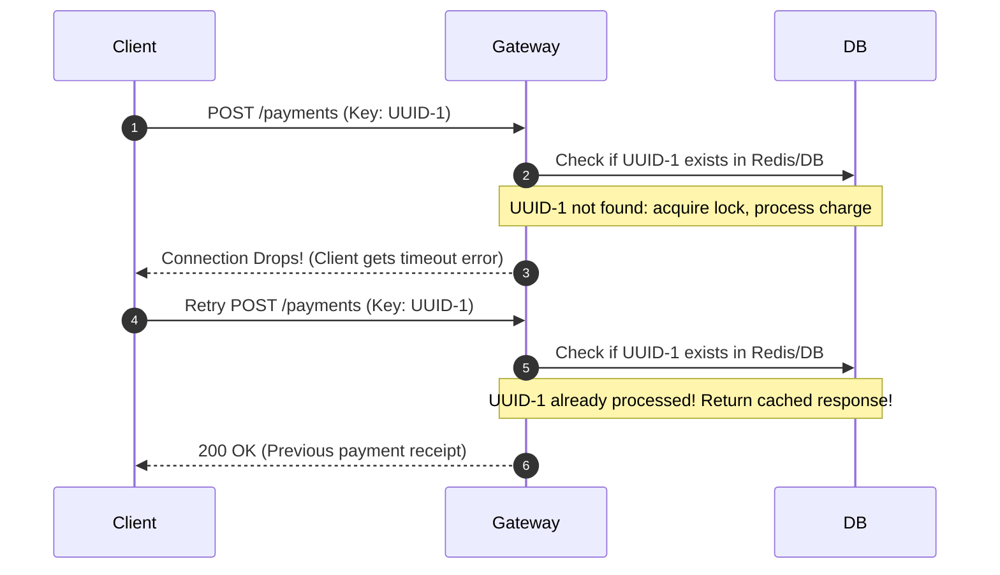

# Chapter 03: REST APIs — Architecture & Design

> **Mentor Note:** "Junior, everyone and their dog puts `@GET` or `app.get('/users')` in their code and calls it 'REST'. But in a system design interview, if you don't know the difference between safe and idempotent, or how `stale-while-revalidate` works, you're leaving free points on the table. Let’s build production-grade API instincts."

---

## 🏛️ What is REST, Really? (Roy Fielding's Blueprint)

REST stands for **REpresentational State Transfer**, introduced by Roy Fielding in his 2000 doctoral dissertation. It is **not** a protocol (it runs on HTTP), but an **architectural style**.

### The 6 Core Constraints of REST:
1. **Client-Server Architecture:** Separation of UI concerns from data storage concerns.
2. **Statelessness:** Every request from client to server must contain *all* the context needed to process it (auth tokens, params). The server does not store client session state in memory.
3. **Cacheability:** Responses must define themselves as cacheable or non-cacheable to prevent clients and proxies from re-fetching stale data.
4. **Uniform Interface:**
   - Resource identification (URIs like `/api/v1/orders/123`).
   - Manipulation of resources through representations (JSON, XML).
   - Self-descriptive messages (Headers like `Content-Type`, `Cache-Control`).
   - **HATEOAS** (Hypermedia As The Engine Of Application State) — linking to next actions in the response.
5. **Layered System:** The client cannot tell if it is talking directly to the origin server, a CDN cache, a rate-limiting gateway, or a load balancer.
6. **Code on Demand (Optional):** Server sending executable scripts (like JavaScript) to the client.

---

## ⚖️ The Holy Grail: Safe vs. Idempotent Methods

Interviewers love this question because 80% of junior developers mess it up.

| HTTP Method | Safe? | Idempotent? | Purpose |
| :--- | :--- | :--- | :--- |
| **GET** | ✅ Yes | ✅ Yes | Retrieve resource representation without altering server state. |
| **HEAD** | ✅ Yes | ✅ Yes | Same as GET, but returns headers only (no body). |
| **POST** | ❌ No | ❌ No | Create a new subordinate resource or execute an operation. |
| **PUT** | ❌ No | ✅ Yes | **Replace** the resource entirely. Running 10 times results in the same state! |
| **PATCH** | ❌ No | ⚠️ Conditional | **Partially modify** a resource (can be non-idempotent if using append/inc operations). |
| **DELETE** | ❌ No | ✅ Yes | Delete a resource. First call returns 200/204; subsequent calls still leave it deleted. |

> 📌 **What does "Idempotent" mean in plain English?**
> An operation is idempotent if executing it **1 time** produces the exact same final system state as executing it **100 times**.

---

## 🛡️ The Idempotency Key Pattern (Production Essential)

Imagine a user with flaky 4G clicks **"Pay $50"** on an e-commerce checkout.
1. The client sends `POST /checkout`.
2. The server processes the payment and charges the credit card.
3. Before the `200 OK` response reaches the mobile/web client, the cell tower drops the connection!
4. The client times out, sees a network failure, and retries the request.
5. **Disaster:** The user is charged $100!

### The Solution: `Idempotency-Key`
```http
POST /v1/payments
Idempotency-Key: e82b8a0e-436f-4a0e-a6c8-1110022d4a5e
Content-Type: application/json

{
  "amount": 5000,
  "currency": "USD"
}
```



*(Android comparison: In Android, you implement this inside an OkHttp `Interceptor` that generates and caches idempotency keys per transactional user action).*

---

## 🚦 Status Codes That Seniors Look For

Stop returning `200 OK` with `{ success: false, error: "Something broke" }`. That is an anti-pattern that breaks CDNs, APM monitoring (Datadog/Sentry), and caching.

### 2xx Success:
- **`200 OK`**: Standard success with body.
- **`201 Created`**: Resource created (e.g., after POST). Must include `Location: /users/42` header.
- **`204 No Content`**: Success, but no body returned (great for `DELETE` or `PUT` actions).

### 3xx Redirection & Caching:
- **`301 Moved Permanently`**: Cached forever by browsers.
- **`304 Not Modified`**: **The caching superhero!** Payload is 0 bytes; tells the client: *"Your cached copy is still valid, use it!"*

### 4xx Client Errors:
- **`400 Bad Request`**: Malformed syntax.
- **`401 Unauthorized`**: Means **Unauthenticated** (Who are you? Missing/invalid token).
- **`403 Forbidden`**: Authenticated, but **no permission** (I know who you are, but you cannot touch this!).
- **`404 Not Found`**: Resource does not exist.
- **`409 Conflict`**: State conflict (e.g., duplicate username or optimistic locking version mismatch).
- **`422 Unprocessable Entity`**: Semantic validation error (e.g., email field is not an email).
- **`429 Too Many Requests`**: Client got rate-limited. Look for `Retry-After: 60`.

### 5xx Server Errors:
- **`500 Internal Server Error`**: Unhandled crash in server code.
- **`502 Bad Gateway`**: Nginx/Cloudflare reverse proxy couldn't talk to the Node/Java backend.
- **`503 Service Unavailable`**: Server is overloaded or undergoing maintenance.
- **`504 Gateway Timeout`**: The Node/Java backend took too long to respond to the reverse proxy.

---

## 🗄️ Web Caching Deep Dive (The `Cache-Control` Matrix)

Caching is the single most effective way to make your web app feel instantaneous.

### 1. `Cache-Control` Directives
```http
Cache-Control: public, max-age=3600, s-maxage=86400, stale-while-revalidate=60
```
- **`public`**: Can be cached by browser AND shared intermediary caches (CDNs, Cloudflare).
- **`private`**: Can ONLY be cached by the user's browser (use for private user dashboards).
- **`max-age=<seconds>`**: How long browser cache is fresh.
- **`s-maxage=<seconds>`**: Overrides `max-age` for shared CDN caches.
- **`no-cache`**: ⚠️ Does NOT mean "don't cache"! It means: *"You can cache it, but you MUST revalidate with the server using ETag before using it."*
- **`no-store`**: True prevention: do not cache anywhere on disk or memory (use for credit card / bank balance).
- **`stale-while-revalidate=<seconds>`**:
  The browser returns the **stale cached response immediately** (instant UI render!), and silently fires a background request to fetch the fresh data for next time!

### 2. Validation with ETags (Conditional GET)
An `ETag` (Entity Tag) is a hash/fingerprint of the resource content:
1. First request:
   ```http
   GET /api/v1/profile
   ──► Server returns 200 OK
   ETag: "w/33a64df551425fcc55e4d42a148795d9f25f89d4"
   ```
2. Subsequent request:
   ```http
   GET /api/v1/profile
   If-None-Match: "w/33a64df551425fcc55e4d42a148795d9f25f89d4"
   ```
3. If profile hasn't changed, server responds:
   ```http
   HTTP/1.1 304 Not Modified
   ```
   **Zero body bytes transmitted.** The browser loads from disk in 1ms!

---

## 📄 Pagination Patterns: Offset vs. Cursor

When building infinite scroll or paginated lists:

### Approach A: Offset-based Pagination
```http
GET /items?offset=20&limit=10
```
- **Backend query:** `SELECT * FROM items ORDER BY id LIMIT 10 OFFSET 20;`
- **Flaws:**
  1. **Performance degradation:** For `OFFSET 100000`, DB must read 100,010 rows and discard the first 100,000.
  2. **The "Skipped Item" bug:** If a new row is inserted at the top while user scrolls from page 1 to page 2, all items shift down, causing user to see duplicate items or skip items!

### Approach B: Cursor-based Pagination (Production Standard)
```http
GET /items?after=eyJpZCI6MTA0fQ==&limit=10
```
- Pass an opaque base64 cursor representing the last seen record's unique sort key (e.g. `created_at` + `id`).
- **Backend query:** `SELECT * FROM items WHERE (created_at, id) < ($last_time, $last_id) ORDER BY created_at DESC, id DESC LIMIT 10;`
- **Why it wins:**
  - High performance via direct B-Tree index scan.
  - Rock solid against real-time insertions or deletions during infinite scroll!

---

Ready for the next paradigm shift? Let's explore **[Chapter 04: GraphQL — Internals & Patterns](file:///home/shaurya/Desktop/learning/web/docs/04_graphql_internals_and_patterns.md)**!
